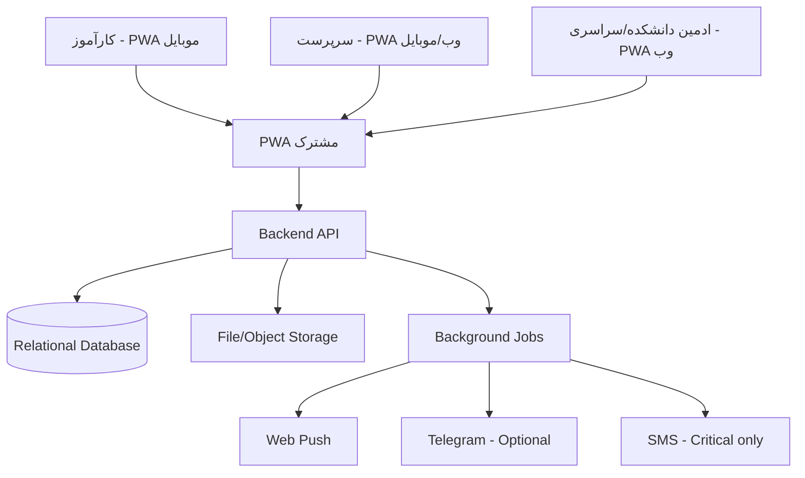

# معماری سطح سیستم

## وضعیت

این سند مرزهای معماری را مشخص می‌کند؛ فناوری‌های اجرایی هنوز انتخاب نشده‌اند.

## نمای سطح بالا

## اجزا

- **PWA:** رابط واحد با تجربه و مجوز متفاوت برای Intern، Supervisor و Admin.
- **Backend API:** منطق محصول، کنترل Role و Scope، گردش کار، ثبت ساعت و گزارش.
- **Relational Database:** داده کاربران، روابط، دوره‌ها، تسک‌ها، Assignmentها، نشست‌ها، تأییدها و Audit.
- **Object Storage:** فایل‌ها و شواهد گزارش.
- **Background Jobs:** اعلان، SLA، بسته‌شدن نشست غیرعادی و هشدارهای قاعده‌محور.

## محدوده مقیاس

با سقف فعلی ۲۰۰ کاربر، یک Backend ماژولار و یک دیتابیس رابطه‌ای احتمالاً کافی است. Microservices، Event Streaming و زیرساخت توزیع‌شده تا زمانی که نیاز واقعی اثبات نشده، توصیه نمی‌شوند.

## اصول امنیت

- Backend مرجع نهایی Authorization است.
- Data Scope در Query و عملیات تغییر اعمال می‌شود.
- پیوست‌ها باید با کنترل دسترسی ارائه شوند.
- تغییرات حساس و وضعیت‌های گردش کار رویدادنگاری می‌شوند.
- ردیابی GPS دائمی بخشی از سیستم نیست.

## اجزای خارج از MVP

نقشه گرافیکی، QR چرخان حضور، تحلیل مهارت، موتور تخصیص هوشمند و یکپارچه‌سازی‌های پیشرفته تا زمان اعتبارسنجی نیاز به فازهای بعد موکول می‌شوند.
