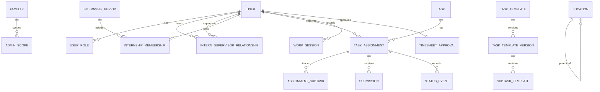

# مدل دامنه و موجودیت‌های اصلی

این مدل مفهومی است و Schema اجرایی دیتابیس پس از انتخاب فناوری و بررسی جزئیات نهایی می‌شود.

## موجودیت‌ها

| موجودیت | مسئولیت |
|---|---|
| `users` | هویت پایه و اطلاعات تماس |
| `user_roles` | نقش‌های قابل انتساب به کاربر |
| `admin_scopes` | Scope دانشکده‌ای یا سراسری ادمین |
| `faculties` | دانشکده‌ها |
| `internship_periods` | دوره، تاریخ و ساعت هدف پیش‌فرض |
| `internship_memberships` | عضویت کارآموز در دوره و ساعت هدف Override |
| `intern_supervisor_relationships` | رابطه تاریخ‌دار کارآموز و سرپرست |
| `supervisor_delegations` | جانشینی فعال و تاریخ‌دار |
| `locations` | درخت مکان دانشگاه |
| `task_templates` | قالب نسخه‌دار رسمی |
| `task_template_versions` | نسخه‌های تغییرناپذیر قالب |
| `subtask_templates` | ریزتسک‌های نسخه قالب |
| `tasks` | نمونه اجرایی از قالب، Quick Task یا کار یک‌باره |
| `task_assignments` | واگذاری مستقل به هر گیرنده |
| `assignment_subtasks` | وضعیت ریزتسک در هر Assignment |
| `status_events` | تاریخچه تغییر وضعیت با عامل و دلیل |
| `submissions` | تحویل‌های کارآموز و نسخه‌های اصلاحی |
| `reviews` | تصمیم سرپرست یا ادمین درباره تحویل |
| `attachments` | پیوست‌های امن مرتبط با تحویل |
| `blockers` | موانع گزارش‌شده |
| `deferral_requests` | درخواست‌های تعویق و تصمیم‌ها |
| `work_sessions` | نشست ورود/خروج کارآموز |
| `timesheet_approvals` | تأیید ساعت در بازه هفتگی |
| `manual_time_adjustments` | اصلاح دستی ساعت با دلیل و Audit |
| `notifications` | Inbox و وضعیت ارسال کانال‌ها |
| `audit_logs` | سوابق عملیات حساس |

## روابط کلیدی

## قیود یکپارچگی

1. در هر لحظه برای هر کارآموز حداکثر یک رابطه سرپرست اصلی فعال وجود داشته باشد. این قید باید در دیتابیس و منطق تراکنشی اعمال شود.
2. رابطه قبلی با `valid_to` بسته شود؛ حذف فیزیکی ممنوع.
3. Assignment مستقل از Task باشد تا تسک گروهی چند گیرنده مستقل داشته باشد.
4. ریزتسک‌های قالب در زمان تخصیص به Assignment کپی/نسخه‌برداری شوند تا تغییر بعدی قالب، سوابق جاری را خراب نکند.
5. هر Assignment یک `assignment_kind` داشته باشد: `intern_work`، `supervisor_own` یا `distribution`.
6. برای هر Task سریع، `origin=quick` و سازنده ذخیره شود.
7. هر `work_session` باید قانون جلوگیری از نشست‌های هم‌پوشان برای یک کارآموز داشته باشد.
8. ساعت تأییدشده با اصلاحیه حذف نشود؛ اصلاح به‌صورت رویداد و رکورد جدا نگهداری شود.
9. فایل‌ها در Storage نگهداری شوند و دسترسی آن‌ها از API مجاز عبور کند.
10. همه زمان‌ها با timezone مشخص و ذخیره استاندارد مدیریت شوند؛ نمایش با timezone دانشگاه انجام شود.

## نکات باز برای طراحی فیزیکی

- سیاست نگهداری فایل و حذف داده.
- مدل دقیق جانشینی و تداخل تاریخ‌ها.
- سیاست کاربرانی که هم‌زمان چند نقش دارند.
- مدل تقویم کاری و تعطیلات برای محاسبه روز کاری.
- جزئیات تراکنش تأیید هفتگی و اصلاح ساعت.
