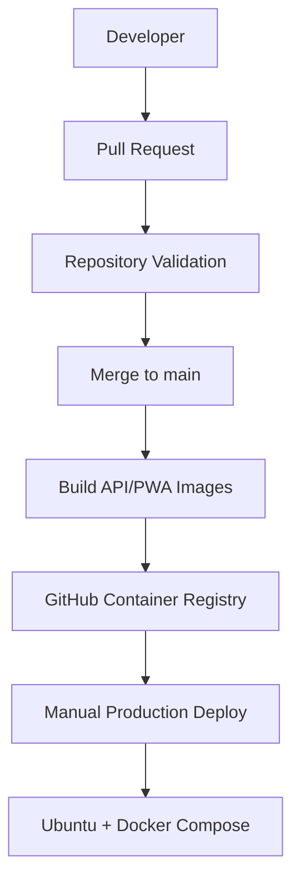

# CI/CD و استقرار

## نمای کلی

## Workflowها

### `validate-repository.yml`

در Pull Request و Push به `main` اجرا می‌شود و ساختار، Markdownهای ضروری و فایل‌های پایه را بررسی می‌کند.

### `publish-container-images.yml`

روی Push به `main` یا Tag نسخه اجرا می‌شود. مسیرهای فعلی:

- `apps/api/Dockerfile` → ایمیج `api`
- `apps/pwa/Dockerfile` → ایمیج `pwa`

تا وقتی Dockerfile وجود نداشته باشد، آن سرویس Skip می‌شود. پس از انتخاب فناوری، Dockerfile و تست‌های Build واقعی اضافه می‌شوند.

نام ایمیج:

`ghcr.io/<owner>/university-internship-platform-<service>:<tag>`

### `deploy-production.yml`

فقط با `workflow_dispatch` اجرا می‌شود. تگ ایمیج را به‌صورت ورودی دریافت می‌کند، با SSH به سرور متصل می‌شود و از Compose برای Pull و به‌روزرسانی سرویس‌ها استفاده می‌کند.

## GitHub Secrets موردنیاز برای Deploy

در GitHub Environment با نام `production` تعریف شوند:

| Secret | کاربرد |
|---|---|
| `DEPLOY_HOST` | آدرس سرور |
| `DEPLOY_USER` | کاربر محدودشده Deploy |
| `DEPLOY_SSH_KEY` | کلید خصوصی Deploy |
| `DEPLOY_KNOWN_HOSTS` | کلید میزبان SSH که از قبل و خارج از Workflow اعتبارسنجی شده است |
| `DEPLOY_PATH` | مسیر Compose روی سرور |
| `GHCR_USERNAME` | کاربر دارای دسترسی خواندن Package |
| `GHCR_READ_TOKEN` | توکن با حداقل Scope لازم `read:packages` |
| `GHCR_NAMESPACE` | نام کاربر/سازمان GitHub با حروف کوچک |

## سرور

- Docker Engine و Docker Compose Plugin نصب باشند.
- کاربر Deploy فقط مجوزهای موردنیاز را داشته باشد.
- مسیر Compose از قبل روی سرور ایجاد و فایل `infra/compose/compose.production.yml` در آن قرار داده شود.
- فایل `.env.production` خارج از Git و با Permission محدود نگهداری شود.
- پیش از Migration یا استقرار نسخه جدید از دیتابیس Backup گرفته شود.
- برای Rollback تگ ایمیج قبلی نگهداری شود.

## Compose

`infra/compose/compose.production.yml` یک الگوی شروع است. مقادیر دامنه، متغیرهای دیتابیس، Secretها، Healthcheck و تنظیمات ذخیره‌سازی قبل از استفاده واقعی باید تکمیل و بازبینی شوند.

## انتشار PWA و API

انتشار API و PWA روی سرور با Docker Compose انجام می‌شود. انتشار خودکار با هر Push توصیه نمی‌شود؛ نسخه تولید با اجرای دستی و تگ مشخص منتشر شود.

## هشدارهای عملیاتی

- `docker compose pull` به‌تنهایی Rollback نیست.
- Migration دیتابیس باید سازگار با نسخه قبلی یا دارای برنامه بازگشت باشد.
- Secretها در Log چاپ نشوند.
- از `ssh-keyscan` بدون اعتبارسنجی مستقل Host Key به‌عنوان اعتماد خودکار استفاده نشود.
